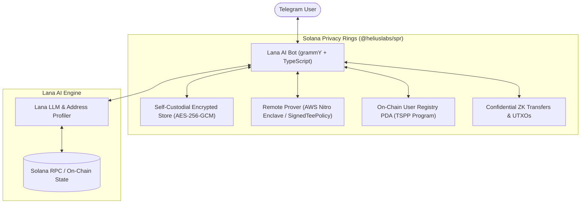

# Lana Solana Intelligence & Privacy Bot

[](https://solana.com)
[](https://helius.dev)
[](https://www.typescriptlang.org)
[](https://grammy.dev)
[](https://opensource.org/licenses/MIT)

An enterprise-grade Telegram bot integrating **Lana AI** for conversational on-chain Solana intelligence and **Helius Solana Privacy Rings (`@heliuslabs/spr`)** for confidential, zero-knowledge payments and encrypted balance management.

---

## 🏗️ Architecture Overview



---

## 🌟 Core Features

### 🛡️ Confidential Payments & Zero-Knowledge Privacy (Helius SPR)
* **Self-Custodial Wallet Generation**: Automatically generates an Ed25519 Solana keypair and corresponding cryptographic Shielded Keypair (`ShieldedAddress`, `ViewingKey`, `NullifierKey`) for each user.
* **Encryption at Rest**: Private keys are encrypted using **AES-256-GCM** with random IVs and integrity authentication tags.
* **Multi-Wallet Support**: Users can maintain multiple wallets (default bot-generated wallet, imported Phantom/Solflare wallets, secondary wallets) and switch the active wallet dynamically with `/switchwallet` or interactive buttons.
* **External Wallet Import (`/importkey`)**: Import existing Phantom or Solflare private keys. Messages containing sensitive keys are **automatically deleted immediately** to ensure chat logs remain clean.
* **Confidential Transfers (`/send`)**:
  * **Private-to-Private**: If the recipient is registered in the Privacy Ring, amounts and notes are completely encrypted on-chain.
  * **Private-to-Public Fallback**: If the recipient is an unregistered public address, the bot prompts with an explicit confirmation before automatically unshielding and settling via a standard Solana transfer.
* **Shielding & Unshielding**:
  * `/deposit`: Shields public SOL into private encrypted UTXOs.
  * `/withdraw`: Unshields private SOL back to any public Solana address.
* **On-Chain Registry Verification**: Verifies on-chain PDAs using `isWalletRegistered` and registers wallets with `/register`.
* **Private Balance Syncing**: Fast balance checks with `/balance` and comprehensive dashboard with `/wallet`.

### 🧠 On-Chain AI Intelligence (Lana AI)
* **Conversational Solana Chat (`/chat`)**: Multi-turn dialogue with real-time streaming, citations, and on-chain intelligence.
* **Address Profiling (`/lookup`)**: Instant reputation card, risk rating, entity tags, and counterparty breakdown.
* **Transaction Explainer (`/tx`)**: Translates raw transaction signatures into human-readable summaries and token flows.
* **Fund Flow Analysis (`/flow`)**: Graph-level summary of where a wallet's funds originate and flow.
* **Portfolio Health (`/portfolio`)**: Evaluates connected wallet performance, token distribution, and risk factors.
* **Inline Queries**: Type `@YourBotName <solana_address>` in any Telegram chat to share an instant wallet profile.

---

## ⌨️ Command Reference

| Command | Arguments | Description |
| :--- | :--- | :--- |
| `/start` | — | Initializes private wallet and displays the interactive onboarding dashboard. |
| `/wallet` | — | Interactive wallet dashboard showing public key, shielded key, balances, and action buttons. |
| `/balance` | — | Quick view of private (shielded) and public SOL balances. |
| `/deposit` | `[amount]` | Shields public SOL into the Helius Privacy Ring pool. |
| `/send` | `<amount> <address \| @user>` | Executes a confidential transfer (or routes to unshielding if recipient is unregistered). |
| `/withdraw` | `<amount> <address>` | Unshields private SOL and withdraws to any public Solana address. |
| `/register` | `[address \| @user]` | Registers current wallet on-chain or verifies another user's Privacy Rings registry status. |
| `/switchwallet` | `[1 \| 2 \| address]` | Lists all user wallets and switches the active main wallet. |
| `/importkey` | `[base58_key]` | Imports a Phantom/Solflare wallet, derives its shielded keypair, and auto-deletes the key message. |
| `/exportkey` | — | Exports the decrypted secret seed for secure external backup. |
| `/lookup` | `<address>` | Analyzes any Solana address for risk score, labels, and transaction history. |
| `/tx` | `<signature>` | Plain-English breakdown of token transfers, fees, and program calls for a transaction. |
| `/flow` | `<address>` | Summarizes top counterparty inflow and outflow connections. |
| `/chat` | `[prompt]` | Enters conversational AI mode for interactive Solana research. |
| `/portfolio` | — | Runs deep analysis on the active user wallet. |

---

## 🔐 Security & Privacy Architecture

### 1. Key Storage & Encryption
* All private keys and seeds are encrypted using **AES-256-GCM** with a master key derived via SHA-256 from `WALLET_ENCRYPTION_KEY`.
* Each encrypted wallet entry carries a unique 12-byte random Initialization Vector (IV) and a 16-byte authentication tag (`authTag`) to protect against tampering.
* The local user store (`data/users.json`) is git-ignored and never committed to version control.

### 2. Zero Chat Leakage Policy
* When a user imports a private key via `/importkey` or Telegram reply, the bot attempts immediate message deletion (`ctx.deleteMessage()`) upon receipt.
* Sensitive keys and seeds are never written to logs or stdout.

### 3. TEE Remote Prover (AWS Nitro Enclaves)
* Zero-knowledge proofs are generated using Helius remote provers protected by **Signed TEE Policies** (`SignedTeePolicy.forNetwork(network)`).
* The client validates the enclave's PCR attestation and establishes an encrypted channel directly to the secure hardware enclave.
* Witnesses, amounts, and private inputs are processed strictly inside isolated hardware memory.

### 4. Viewing Keys vs. Nullifier Keys
* **Viewing Keys**: Used exclusively to decrypt incoming UTXOs and query private balances.
* **Nullifier Keys**: Used to prove spend ownership inside zero-knowledge circuits without exposing the underlying private key.

---

## 🚀 Getting Started

### Prerequisites
* **Node.js**: v20+ or v22+
* **npm**: v10+
* **Telegram Bot Token**: Created via [@BotFather](https://t.me/BotFather)
* **Helius API Key**: Available from [Helius Developer Dashboard](https://dashboard.helius.dev/)
* **Lana API Key**: Available from Lana AI

---

### Installation

1. **Clone the repository:**
   ```bash
   git clone https://github.com/your-username/lanaAI-bot.git
   cd lanaAI-bot
   ```

2. **Install dependencies:**
   ```bash
   npm install
   ```

3. **Configure Environment Variables:**
   ```bash
   cp .env.example .env
   ```
   Edit `.env` and fill in your credentials:
   ```env
   NODE_ENV=development
   TELEGRAM_BOT_TOKEN=1234567890:ABCdefGHIjklMNOpqrSTUvwxyz
   
   # Lana AI
   LANA_API_KEY=your_lana_api_key
   LANA_BASE_URL=https://lana-api.helius-experiments.com
   LANA_NETWORK=devnet
   
   # Helius Solana Privacy Rings
   HELIUS_API_KEY=your_helius_api_key
   HELIUS_RPC_URL=https://devnet.helius-rpc.com/?api-key=your_helius_api_key
   WALLET_ENCRYPTION_KEY=replace_with_a_secure_random_32_byte_secret
   DATA_DIR=./data
   ```

4. **Verify TypeScript compilation:**
   ```bash
   npm run typecheck
   ```

5. **Run in Development Mode:**
   ```bash
   npm run dev
   ```

6. **Build & Run in Production:**
   ```bash
   npm run build
   npm run start
   ```

---

## 🧪 Testing on Solana Devnet

1. Open Telegram and send `/start` to your bot.
2. Run `/wallet` to view your assigned Solana public address.
3. Request Devnet SOL via the [Solana Faucet](https://faucet.solana.com/) or CLI:
   ```bash
   solana airdrop 1 <YOUR_BOT_PUBLIC_ADDRESS> --url devnet
   ```
4. Register your address on-chain:
   ```text
   /register
   ```
5. Shield funds into the Privacy Ring:
   ```text
   /deposit 0.2
   ```
6. Check your private balance:
   ```text
   /balance
   ```
7. Send a confidential transfer to another wallet or Telegram username:
   ```text
   /send 0.05 @friend
   # or
   /send 0.05 <recipient_solana_address>
   ```

---

## 🤝 Contributing

Contributions, issues, and feature requests are welcome!
1. Fork the Project.
2. Create your Feature Branch (`git checkout -b feature/AmazingFeature`).
3. Commit your Changes (`git commit -m 'Add some AmazingFeature'`).
4. Push to the Branch (`git push origin feature/AmazingFeature`).
5. Open a Pull Request.

---

## 📄 License

Distributed under the MIT License. See `package.json` for details.
